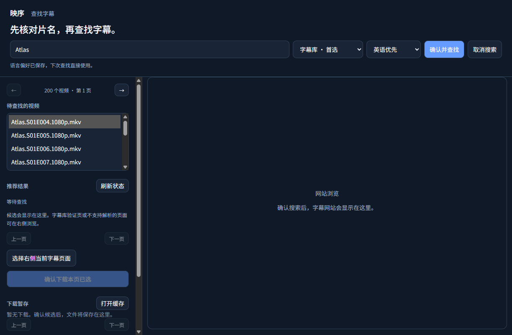

# 映序

让每一份字幕，回到正确的位置。

拖入文件夹，核对匹配，确认整理。从查找字幕到整理完成，一处看清。

[下载 Windows 版](https://github.com/mason2237/YingXu/releases/download/v0.11.0-rc.2/YingXu-0.11.0-rc.2-windows-x64.zip) · [查看更新](https://github.com/mason2237/YingXu/releases/tag/v0.11.0-rc.2)

适用于 Windows 11 x64 · 0.11.0-rc.2 预发布版

## 从一个文件夹开始

选择或拖入视频文件夹，映序会扫描视频和字幕，列出匹配关系。搜索、筛选、排序和查看详情，找到需要处理的文件。长文件名可以在详情中完整查看。

自动匹配不确定时，换一份字幕、手动确认，或先跳过。原来的名称、整理后的名称放在一起，确认后才修改文件，已有文件不会被覆盖。

## 缺少字幕，接着找

从文件名提取电影或剧集名称，批量查找合适的字幕。默认优先中英双语，也可以保存自己的语言偏好。

优先使用字幕库，遇到网站验证或无结果时，可切换 SubHD 等备用来源。选择并确认下载后，支持的页面会自动完成普通下载步骤，随后检查内容、解压并加入待审阅列表。网站验证码和无法识别的步骤仍需你处理。

字幕进入工作台后仍可核对和调整，不会因下载成功就直接整理。网站是否可用、字幕版本和时间轴是否适合当前片源，仍需留意。

## 已经有字幕，就少一步

视频内已有符合语言偏好的字幕，直接通过，无需再次下载或导出。识别结果可以手动调整；烧录在画面上的字幕暂不支持识别。

## 下次打开，接着整理

已提交的匹配、人工确认和跳过选择会保存为草稿。重新打开时先核对原文件，再恢复审阅；文件发生变化时会提示重新扫描。

暂停的批量下载队列也会保留。点击继续并重新确认后再下载，启动时不会自动访问字幕网站。支持续传的网站会在核对下载对象后接着下载；链接过期需要重新获取，blob 下载需要重新开始。

## 每一步，都有记录

整理结果、异常原因和操作记录保存在本机，也可以导出。意外中断后，先查看恢复预览，再决定是否继续。

需要反悔时，可从记录中预览撤销。文件被编辑、原位置被占用或身份无法核实时，映序会停止，保护之后的修改。旧版记录可以查看，但不支持推测性撤销。

下载缓存可以直接打开，也可以释放可回收内容。活跃任务、草稿和恢复或撤销仍需使用的文件会保留。

## 看着舒服，用着顺手

浅色、深色或跟随系统，玻璃质感、按钮回弹和细腻光影。动效可以调整或关闭；支持 HDR 且 Windows 已开启 HDR 的设备可呈现更明亮的高光，应用不会更改系统开关。

## 开始使用

1. 下载并完整解压，双击 `YingXu.exe`。请保留解压后的所有文件，无需安装开发环境。
2. 选择文件夹，核对匹配；缺少字幕时，可打开“在线字幕”查找。
3. 点击“预览变更”，核对名称和提示，确认后整理。

`Ctrl+F` 搜索 · `Ctrl+Enter` 预览 · 方向键选择文件

更新时请解压到新文件夹，保留旧版及整个数据目录。此前旧架构版本的设置和记录不会自动迁移。[使用说明](release/README.zh-CN.md)

## 使用须知

文件整理在本机完成，不上传视频；在线搜索只在你确认后发送片名。截图使用生成的示例数据。

当前为未签名的预发布版，已在开发机完成主要流程检查，尚未在全新 Windows 环境测试。持续高刷新率目标仍未完成验收，不能保证所有设备稳定达到 120fps。[验证与已知限制](docs/RELEASE_VALIDATION.md)

## 开发与许可

[开发指南](docs/DEVELOPMENT.md) · [架构](architecture.txt) · [待办](todo.txt) · [业务原型教程](docs/learning.md) · [变更记录](CHANGELOG.md)

当前源码和运行包使用 Electron + Python，已移除 Qt 宿主和回退源码。Python 业务通过小型版本化接口与桌面连接，模型、用例、ports 和适配器独立分层，测试按用途分组，benchmark 独立运行。

原创部分采用 [PolyForm Noncommercial 1.0.0](LICENSE)，允许按许可个人免费使用、学习、修改和非商业性再分发；商业用途须提前取得版权所有者的单独授权。

第三方组件保留各自许可和作者署名，见 [NOTICE](NOTICE)、[第三方声明](THIRD_PARTY_NOTICES.md) 和 [依赖说明](docs/DEPENDENCIES.md)。

Required Notice: Copyright 2026 YingXu project authors and contributors.
