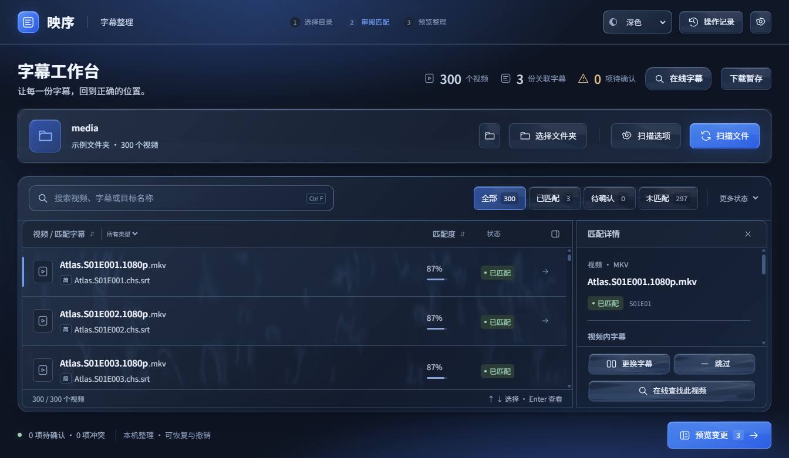

# 映序 · 视频字幕整理器

一款在本机整理视频字幕的 Windows 桌面工具。使用 PySide6、Qt WebEngine 和本地 HTML/CSS/JavaScript，支持明暗主题、液态玻璃按钮与可关闭的动效。



## 下载与运行

在 [Releases 页面](https://github.com/mason2237/YingXu/releases/tag/v0.8.0-rc.2)下载 [Windows x64 运行包](https://github.com/mason2237/YingXu/releases/download/v0.8.0-rc.2/YingXu-0.8.0-rc.2-windows-x64.zip)，完整解压后运行 `YingXu/YingXu.exe`。请保留旁边的 `_internal` 文件夹，不能只复制 EXE。

- 运行包自带 Python/Qt 所需组件，不需要另装 Python、Node 或浏览器，也不依赖开发服务器。
- 当前 Windows 11 x64 环境已完成启动和核心流程验证。**未进行干净 Windows 系统测试**；其他设备的显示效果和兼容性可能不同。程序未签名。
- 文件在本机处理，不上传用户视频、字幕或目录。联网只用于开发者安装依赖；应用资源离线加载。

## 使用流程

1. 选择或拖入一个文件夹，按需设置递归扫描和字幕移动选项。
2. 扫描后查看匹配列表，通过搜索、排序和状态筛选定位视频。
3. 对低可信匹配人工确认、更换字幕、添加语言或跳过。
4. 点击“预览变更”，检查原名称、目标名称与冲突。
5. 勾选确认后执行整理，再查看结果与本地操作记录。

预览和审阅不会改动媒体文件；实际修改需要明确确认。已有目标不会被覆盖。尚未提供撤销功能，建议先用小目录熟悉流程。

## 界面与快捷键

- 右上角支持浅色、深色、跟随系统。外观设置可关闭玻璃、雾气、粒子，或开启减少动态。
- 玻璃按钮可轻拖回弹；真实拖动不触发点击。进度条使用实际任务进度，未知总量时不显示虚构百分比。
- `Ctrl+F` 搜索，`Ctrl+K` 快捷操作，方向键/Home/End/PageUp/PageDown 选行，Enter 查看详情，`Ctrl+Enter` 预览。
- `Ctrl+R` 刷新页面可恢复 Python 中的当前状态，不会重放文件操作；尚未开始执行的确认凭证会失效。

操作记录默认位于 `%LOCALAPPDATA%/YingXu/history.jsonl`；外观偏好保存在当前用户的 `YingXu/SubtitleOrganizer` 设置中。记录和个人文件不会随仓库或发布包提供。

## 从源码运行

需要 Windows、64 位 Python 3.12。运行包用户无需执行以下步骤。

```powershell
py -3.12 -m venv .venv-web
.venv-web/Scripts/python.exe -m pip install --only-binary=:all: -r requirements-web-lock.txt
.venv-web/Scripts/python.exe run_web.py
```

依赖版本、第三方许可和 Qt 库替换说明见 [DEPENDENCIES.md](docs/DEPENDENCIES.md)。`requirements.txt` 是历史 Tkinter 入口的标准库说明，当前 Web 应用使用 `requirements-web*.txt`。

## 构建与检查

```powershell
.venv-web/Scripts/python.exe scripts/build_web.py --release --zip
.venv-web/Scripts/python.exe scripts/audit_public.py --history
```

输出位于 `outputs/stage8-release/<版本>/`。开发时可按需运行以下检查；使用临时目录，不应对个人媒体运行自动化测试。

```powershell
.venv-web/Scripts/python.exe -m unittest discover -s tests -v
.venv-web/Scripts/python.exe -m unittest discover -s tests/web -v
.venv-web/Scripts/python.exe work/check_local_workspace.py
```

当前交付复用已完成的 32 项业务、14 项后端、11 项边界测试和真实临时目录整理结果；本轮只补许可、公开内容检查和修改打包范围所需的启动检查。[发布说明](release/RELEASE_NOTES.md)及[公开发布步骤](docs/PUBLISHING.md)记录验证范围。没有进行干净系统验收。

## 目录与开发记录

- `yingxu/`：独立文件业务逻辑、原 Qt 界面和 Web 宿主/受限通信接口。
- `frontend/`：本地 Web 工作台及已标明来源的第三方效果。
- `scripts/`：构建、许可资料收集、公开内容检查和发布包整理。
- `tests/`、`work/check_*.py`：单元检查及真实窗口验证工具。
- `docs/`、[PROGRESS.md](PROGRESS.md)：阶段记录、接口约定与已知限制，保留以前的测试结果。

默认入口 `run_web.py` 是真实工作台；`run_preview.py` 保留第四阶段 Qt 工具。`run_web_preview.py` 和 `run_effects_preview.py` 仅供显式示例/效果开发，示例资源不进入正式运行包。

## 许可证与商业授权

项目原创代码及项目自有资源采用 **[PolyForm Noncommercial License 1.0.0](LICENSE)**，LICENSE 使用官方完整原文，未修改条款。允许按该许可证进行个人免费使用、学习、修改和非商业性再分发；**商业使用必须提前获得相应版权所有者的单独授权**。上述说明是摘要，具体范围以 LICENSE 为准。

Required Notice: Copyright 2026 YingXu project authors and contributors.

授权申请请通过本仓库的 Issues 联系维护者。项目属于源码公开、限制商业使用的软件。第三方组件继续适用自身许可证，项目的非商业限制不会覆盖它们独立授予的权利；原有署名见 [NOTICE](NOTICE)、[THIRD_PARTY_NOTICES.md](THIRD_PARTY_NOTICES.md) 和 [licenses/](licenses/)。
