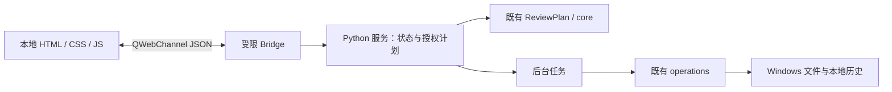

# Web UI 迁移审查与实施草案

更新：2026-10-23。状态：**阶段 5、阶段 6 及 6.1/6.2/6.3a/6.3b 已完成；阶段 7 真实工作台已接通并完成定向验收，等待用户确认阶段 8**。本轮证据与未实测范围见 [STAGE7_VERIFICATION.md](STAGE7_VERIFICATION.md)。

2026-10-21 r3.2 补充：用户要求尽可能采用参考仓库的全部适用效果，减少电脑控制。当前仅复用 focus/modal，玻璃自写；新增 6.1 原版效果全量清单/移植对照、6.2 完整明暗主题、6.3 覆盖补齐/验收。详情及每步检查点见 [DESIGN_PLAN.md](DESIGN_PLAN.md)。常规检查优先代码/API/程序内自动化，电脑控制仅用于必要原生交互和少量实际窗口抽查。

6.1 实施更新：上述“仅 focus/modal”为方案修订时的基线。现已采用 19 个原版 Lens 文件及独立生命周期/业务适配器，18 类控件全部展示、目录/筛选接入原材质。出处与未采用项见 [UPSTREAM_EFFECTS.md](UPSTREAM_EFFECTS.md)，实际检查见 [STAGE61_VERIFICATION.md](STAGE61_VERIFICATION.md)；主业务 bridge 及真实文件接口仍未扩展。

6.2 实施更新：用户选择增强效果。应用新增完整浅色/深色/系统跟随、QSettings 外观偏好、启动防白闪、180ms Overture 虹膜适配及 Qt/DWM 配色。工作台和原版效果页唯一注册 `appearance` 对象；`bridge` 仍只向第五阶段诊断页注册。最新实际检查见 [STAGE62_VERIFICATION.md](STAGE62_VERIFICATION.md)。

### 已实施的外观接口（6.2）

| 方法 / 信号 | 格式 | 权限 |
| --- | --- | --- |
| `appearance.getState()` | 返回 JSON：`theme/resolvedTheme/systemTheme/glassEnabled/strength/particlesEnabled/reducedMotion/mistEnabled` | 只读外观 |
| `appearance.update(jsonPatch)` | 最多 2048 字符，返回 `{ok,state,error?}`；未知键或非法值整条拒绝 | 只保存六项外观偏好（6.3a 新增 mistEnabled） |
| `appearance.changed(jsonState)` | 系统明暗或偏好变化后发送完整外观状态 | 仅通知，不触发文件任务 |

`theme` 仅 system/light/dark，`strength` 仅 standard/enhanced，其余四项严格为布尔值；resolvedTheme/systemTheme 不可写。6.3a 的 mistEnabled 默认 true，原五字段设置可以继续加载。Qt 主线程串行更新，重复值不重复发信号。保存失败保留旧状态并提示；非法/损坏持久数据回退默认。使用固定 QSettings 命名空间及固定键，不接收路径、动态对象名或命令。样本页之外的主文档、子框架、网络资源仍被原边界拒绝。外观写入不授予真实目录或整理能力。
最初审查轮仅修改文档；用户随后授权“开始”，现已建立独立 Web 宿主、通信和只读样本验证，记录见 [STAGE5_VERIFICATION.md](STAGE5_VERIFICATION.md)。参考仓库脚本未执行，旧界面保留。
主计划为 [DESIGN_PLAN.md](DESIGN_PLAN.md)，交接入口为 [PROGRESS.md](../PROGRESS.md)。

## 1. 决策摘要

建议采用 **PySide6 + QWebEngineView + 原生 HTML/CSS/ES modules + QWebChannel**。
Python 保持业务与文件操作的唯一执行方；网页负责展示、输入及交互状态。
独立增加 Web 入口，保留 `run_preview.py`、`yingxu/qt_ui/` 和阶段四 EXE。

参考仓库实际为三套原生 Web 设计系统，并非 React/Vue 应用模板。优先复用经审查的 DOM 控件、可访问性处理和设计变量；以 Lens 的中性底色/品牌蓝为色彩基础，参考 Overture 的控件状态与浮层生命周期。统一为映序自己的单一设计系统，避免直接混用三套皮肤。
2026-10-21 用户确认补充：第六阶段加入局部液态玻璃与可关闭的轻量粒子，并在真实窗口验收观感。玻璃限定于顶部工具栏、浮层和选中控件；粒子限定于空状态或整理完成时的短反馈。文件列表保持清晰稳定，支持减少动画、效果关闭和普通材质回退。
摄影舞台、音效、展示站翻页及持续全屏粒子不纳入。第五阶段仍只搭建架构，不提前实现这些效果。
如果后续确认需要复杂前端框架，应另列收益与迁移成本，不在本轮引入。

## 2. 第四阶段真实基线

核对版本：`d3db0fe6d861b1cdf2ae8919a0abeab698d2c020`，标签 `stage4-complete`；审查开始时工作树干净。
现有验证记录：[STAGE4_VERIFICATION.md](STAGE4_VERIFICATION.md)。记录包含 32 项 Python 回归、Qt 实际文件整理/冲突阻止/导出/历史流程及 EXE 启动；**本轮未重跑这些检查**。
本轮重新核对 EXE 存在、大小 39,547,039 字节，SHA256 为 `3860B7359D386A7CAB1DD34C20C3E33ECDB939EC191C3769768BE94D8F58AA55`，与原记录相符。

| 已有文件 | 实际职责 | 迁移处理 |
| --- | --- | --- |
| `yingxu/core.py` | 收集视频/字幕、文件名解析、相似度、初始一对一匹配、目标名及冲突编号 | 保持原业务函数；不为换 UI 重写 |
| `yingxu/review.py` | ReviewPlan、多语言关联、候选、人工分配/移除/确认/跳过、目标重算 | 保留内存模型；服务层映射稳定 ID 和版本 |
| `yingxu/operations.py` | PlanSnapshot、文件身份复核、不覆盖执行、停止、结果、HistoryStore、独占导出 | 保留；外层增加调用状态约束，不直接暴露 run_batch |
| `yingxu/qt_ui/window.py` | Qt 控件、工作流编排、选择目录/拖拽/剪贴板/打开位置 | 旧版完整保留；新服务层适配工作流与系统动作 |
| `yingxu/qt_ui/model.py` | Qt 表模型、代理筛选/排序、绘制及展示数据转换 | Qt 类型不可传网页；新 DTO 复用含义，前后端按契约传 JSON |
| `worker.py` / `apply_worker.py`（qt_ui 内） | QThread 扫描/执行、信号与停止状态 | 复用后台调用方式；新任务管理器不依赖 QWidget |
| `yingxu/qt_ui/flow.py` | 预览确认、结果、历史弹窗 | 阶段 7 接入 Web 视图；沿用同一冻结计划和业务结果 |
| `run.py` / `run_preview.py` | 旧 Tkinter / 当前完整 Qt 工作台入口 | 保留，增加独立 `run_web.py` |
| `scripts/build.py` | 仅支持阶段 1–4；onefile；显式资源只有图标 | 后续独立增加 Web 构建规则与产物目录 |

已完成的功能：目录选择及单目录拖拽、后台扫描、搜索/筛选/排序、人工候选处理、多语言匹配、最终变更预览、勾选确认、真实整理、进度/停止、结果导出、最近 30 次本地记录。
“元数据”现指名称/路径/扩展名、由文件名解析的集数与语言、匹配评分；没有视频时长/编码探测，不把媒体探测列入迁移范围。

### 现有边界与待补项

- 安全撤销未实现，保持单独增强项；Web 界面不显示可用的撤销按钮。
- 人工审阅随重扫重建；执行历史保存在本地，不能等同于可恢复的审阅会话。
- 扫描取消是等待计算结束后丢弃结果；整理停止是完成当前文件后停止。界面必须说明真实语义。
- 根目录错误有提示；core 递归扫描可能忽略不可读子目录。改善这一行为须单独记录和回归，不混进 UI 迁移。
- 当前确认在 `Workspace.preview_changes()` → `PreviewDialog.exec()` → `_start_apply()` 中约束。`run_batch()` 本身没有一次性授权令牌。
- 当前防重复靠窗口内互斥和禁用控件；网页刷新/重连必须增加 Python 服务状态保护。
- 历史在批次结束时写入；进程异常退出可能缺失整批记录。不能据此自动重试、恢复或撤销。
- 大规模匹配、真实多 DPI/跨显示器、无开发环境 Windows 尚未专项验收。匹配复杂度不能靠列表虚拟化解决。

## 3. 参考仓库审查

用户网址对应 [ruiqichenbiec/design-systems](https://github.com/ruiqichenbiec/design-systems)。
审查固定提交：[7a424c93b9be13cf835b91ea67495fec2ec0584e](https://github.com/ruiqichenbiec/design-systems/commit/7a424c93b9be13cf835b91ea67495fec2ec0584e)。
已读取完整文件树、根 README/LICENSE、三套体系说明与 package.json，以及下表相关实现、样式、变量和素材来源。未执行其构建/测试，未做本机 WebEngine 兼容认证；展示网址的网页提取失败后改用对应仓库源码核对。

| 体系/结构 | 技术与交互事实 | 对映序的价值与限制 |
| --- | --- | --- |
| 根 `index.html`、`exposure/`、`ds-viewer/` | HTML/CSS/JS；iframe 装载各体系、滚动切站、加载动画；目录生成器使用 Node | 是展示站结构，不是文件工作台；不移植首页、iframe 容器或滚轮接管 |
| Lens `lab/design-system/` | 原生 ESM、无第三方运行时依赖；18 类组件；CSS/JSON tokens、WebGL2 玻璃、弹性手势、合成声音 | 中性文字/底色/蓝色及语义控件可借鉴；`index.js` 引入多个材质模块，应按文件选择复用 |
| Lens 表格与 flat | `showcase-charts.js` 的表格按 8 行分页，绑定展示数据；`exposure/lens.html` 的 flat 只让选中/完成状态变为实色 | 并非现成大数据表格；flat 仍保留未选中/移动中的玻璃，不能直接视为全套简约皮肤 |
| Lattice | 原生 JS + three.js 0.186.1、WebGL2；14 类组件；点场、命令面板、开关、进度；构建依赖 esbuild，测试用 playwright-core | 语义/键盘模式可参考；点阵舞台、点阵字、光标特效与大量文件阅读不匹配 |
| Overture | 原生全局 API `Overture.mount/define`；46 类组件；core/controls/overlays 等分模块；three.js 固定副本供 GPU 模块 | 原生表单、状态反馈、浮层开关和资源清理有复用价值；品牌字体、朱红、直角摄影皮肤需重新映射 |
| Overture 动效 | Web Animations、光圈/显影/弹簧；部分默认动效数百毫秒；WebGPU/WebGL2 为图形模块服务 | 提取短暂反馈原则；业务控件收敛到约 120–180ms，服从 reduced-motion，不依赖 GPU/新式转场 API |

直接证据：[Lens 包](https://github.com/ruiqichenbiec/design-systems/tree/7a424c93b9be13cf835b91ea67495fec2ec0584e/lens/lab/design-system)、[Lens flat 实现](https://github.com/ruiqichenbiec/design-systems/blob/7a424c93b9be13cf835b91ea67495fec2ec0584e/exposure/lens.html)、[Lattice 依赖](https://github.com/ruiqichenbiec/design-systems/blob/7a424c93b9be13cf835b91ea67495fec2ec0584e/lattice/package.json)、[Overture 控件](https://github.com/ruiqichenbiec/design-systems/blob/7a424c93b9be13cf835b91ea67495fec2ec0584e/overture/src/controls.js)、[浮层](https://github.com/ruiqichenbiec/design-systems/blob/7a424c93b9be13cf835b91ea67495fec2ec0584e/overture/src/overlays.js)。

### 许可证与素材结论

| 对象 | 核对结果 | 采用条件/决定 |
| --- | --- | --- |
| 仓库原创代码 | 根 LICENSE：MIT，Copyright (c) 2026 DayDreamInAReverie | 可依声明使用、修改和分发，包括商业用途；复制或实质复用时保留版权与许可全文。将固定提交、路径、改动记录写入第三方清单 |
| three.js | 仓库声明 MIT 并随附 THREE-LICENSE.txt | 若引入须保留其许可；先评估局部效果是否需要，避免为短反馈导入整套图形引擎 |
| Bodoni Moda / Manrope | `overture/project/fonts/` 各有 SIL OFL 文本与版权 | 可以按 OFL 随软件分发，需保留许可；修改字体还需核对保留字体名约束，不单卖字体。当前采用 Windows 已安装系统字体，无需打包它们 |
| 其他网页字体 | 根首页和部分示例请求 Google Fonts | 去除远程请求；如以后随包分发，逐个核对字体文件及许可，不能将仓库 MIT 自动套到所有字体 |
| 照片/参考图/宣传片 | SOURCES 声明示例图为 AI 生成，并记录部分来源和派生过程 | 该声明不足以独立核实全部素材权利；文件工作台不需要这些素材，本计划不随包复用 |
| Qt/WebEngine/Chromium | 独立于参考仓库的许可体系 | 第八阶段随实际发行依赖收集许可与来源，核对 LGPL/其他条款要求，不把 MIT 视为覆盖整套发行物 |

许可证据：[根 LICENSE](https://github.com/ruiqichenbiec/design-systems/blob/7a424c93b9be13cf835b91ea67495fec2ec0584e/LICENSE)、[SOURCES](https://github.com/ruiqichenbiec/design-systems/blob/7a424c93b9be13cf835b91ea67495fec2ec0584e/overture/SOURCES.md)、[字体许可目录](https://github.com/ruiqichenbiec/design-systems/tree/7a424c93b9be13cf835b91ea67495fec2ec0584e/overture/project/fonts)、[Qt WebEngine 许可](https://doc.qt.io/qt-6.8/qtwebengine-licensing.html)。
上游 README 明确按原样提供且不再积极维护；复用后本项目承担维护与回归，不能将“有组件”理解为已经通过本应用生产验收。

### 移植分级

- **可直接装载/小幅适配**：原生 DOM/SVG、CSS 变量、无外部依赖的工具函数；如 Lens `focus.js` 不依赖 renderer，但是否采用仍需检验 Ctrl 组合键与中文输入法。系统 `:focus-visible` 优先。
- **需定向适配**：Overture core/controls/overlays 的生命周期与键盘交互、输入/开关/通知/弹窗；剥离示例默认行为、硬编码文案、声音和长动效，改为业务回调及显式状态。当前 Dialog 是“作品标题保存”示例，不能直接充当文件确认。
- **需为业务实现**：字幕工作台、稳定行 ID、多字幕详情、虚拟列表/分页数据源、冲突预览、进度/历史和 QWebChannel 服务。参考仓库没有这些文件业务能力。
- **效果专项适配（r3.2 扩大范围）**：全面审查 Lens/Lattice/Overture，尽可能采用原有玻璃/材质/手势/控件/状态/进度/通知等适用效果及必要依赖，建立逐项来源与采用状态清单。折射使用可控背景，文件文字保持 DOM；通过按需加载、效果强度与减少动态设置保持大列表可读及停帧。
- **可选与开发验收**：粒子/点场、声音、自动移动等先核对实际用途、依赖与本地表现；可选声音默认关闭，暂无业务入口的效果在独立开发验收页展示。每个未采用项记录具体理由。
- **不纳入业务页面**：无关的整站展示导航、摄影/视频与远程字体；不执行未审查的 npm/Node/Python 工具。r3.1 对效果/声音的统一排除由上述逐项审查规则取代。

## 4. 目标架构与目录建议

阶段 5 的诊断服务保持独立；阶段 7 新增 workspace 专用 bridge/service/data/worker，调用既有 core/review/operations。前端通过明确模式选择 LocalAdapter 或显式 PreviewAdapter，真实工作台不加载 fixtures。

```text
run.py / run_preview.py              # 保留旧入口
run_web.py                          # 阶段 7 真实工作台（bridge + appearance）
run_web_foundation.py               # 保留阶段 5 通信诊断
run_web_preview.py                  # 显式示例；仅 appearance，无文件接口
run_effects_preview.py              # 原版效果独立验收；仅 appearance
yingxu/
  core.py / review.py / operations.py # 保留核心
  qt_ui/                            # 保留第四阶段 UI
  web_ui/
    window.py                       # QWebEngineView/生命周期、原生选择/拖入/ID 操作
    resources.py                    # 本地资源 scheme 与导航/网络限制
    bridge.py                       # 保留诊断 bridge
    protocol.py                     # 版本、DTO、错误码、参数约束
    service.py / workers.py          # 保留只读诊断样本
    workspace_bridge.py             # 生产白名单、会话、请求去重、原生延迟回复
    workspace_protocol.py           # 严格业务字段、类型/分页约束
    workspace_service.py            # Python 审阅/快照/一次性确认/任务/历史
    workspace_data.py               # DTO、稳定 ID、查询/候选分页、审阅原子更新
    workspace_worker.py             # 后台任务、真实进度、取消与错误分类
frontend/
  index.html / workspace.html / effects.html # 诊断 / 双模式工作台 / 效果对照
  css/{base,tokens,components,workspace}.css
  js/{app,bridge-client,workspace,store,model}.js
  js/{channel,local-adapter}.js      # 共享一个 channel；生产任务适配器
  js/components/                    # 列表、详情、预览、弹窗、结果与通知
  js/preview/{fixtures,adapter}.js   # 仅界面测试；正式发行时排除
  vendor/design-systems/             # 只放实际采用并审查过的片段
  vendor/design-systems/lens/        # 19 个原文件，ORIGIN.json 记录 Git blob
  vendor/design-systems/UPSTREAM.md  # 提交、原路径、修改原因与许可
tests/web/                          # 协议、生命周期、安全与前端交互用例
work/check_web_{foundation,workspace}.py # 真实 WebEngine 检查
work/check_web_adapter.mjs          # 前端适配器 8 项检查，开发用 Node 22+
work/check_local_workspace.py       # 真实目录/原生控件/实际整理的隔离全流程
work/check_lens_preview.py          # 18 类控件/像素/回退/停帧/释放的实际检查
work/check_lens_math.mjs            # 原版材质/物理/GPU预算/PCM 的 7 项检查
requirements-web.txt                # 与旧 .venv 隔离的直接依赖
requirements-web-lock.txt           # 验证后的精确版本
scripts/build_web.py                # 后续独立 WebEngine 打包
THIRD_PARTY_NOTICES.md               # 已采用片段清单；完整 MIT 在 vendor/LICENSE
```



### 运行时与依赖

- 原 `requirements-qt.txt` / `.venv` 保留 Essentials/shiboken6 6.8.3，没有 WebEngine；不能凭 `.pyi` 判断可用。
- 阶段 5 已建立 `.venv-web`，按官方 PySide6 6.12.0 组合安装并锁定：Essentials/Addons/shiboken 为 6.12.0，官方独立 WebEngine/Pdf 包为 6.12.0.140，Chromium 140.0.7339.225。依赖见 `requirements-web-lock.txt`；发行前仍需核对维护状态与支持范围。旧环境及锁文件保留。
- 推荐同源 `yingxu://app/` 本地资源方案：在 QApplication 前注册 scheme，handler 只服务前端静态文件清单和 Qt 自带 qwebchannel.js，正确返回 MIME。禁止路径穿越及任意磁盘映射，不开启广泛本地文件访问权限。
- 阶段 5 验证 ES modules、资源路径和 QWebChannel；若选定 Qt 版本不能满足，先记录并评审 qrc/经典脚本替代，不通过关闭浏览器安全限制解决。
- 独立 profile、拒绝远程请求/外部导航/新窗口/下载，CSP 限制本地脚本与资源，禁止 eval/内联业务脚本及 iframe。发布关闭远程调试；保留 Chromium sandbox。
- 网页只通过固定 bridge 对象访问 Python；不提供 shell、任意文件读写、动态函数名调用。应用无需 Node、开发服务器、CDN或用户浏览器。
- 原生 Qt 接收单目录拖放与 QFileDialog 结果，验证后签发 folderId；不依赖浏览器 File 对象获取 Windows 路径。原生层负责目录位置打开与剪贴板动作。

Qt 依据：[QWebChannel JavaScript API](https://doc.qt.io/qt-6/qtwebchannel-javascript.html)、[自定义资源 scheme](https://doc.qt.io/qt-6/qwebengineurlscheme.html)、[WebEngine 部署](https://doc.qt.io/qt-6.8/qtwebengine-deploying.html)。实际兼容性以阶段 5 锁定版本验证为准。

## 5. Python ↔ JavaScript 通信 v1（阶段 7 已实施）

生产白名单以 workspace_protocol.py 为准；app.ping / diagnostics.runSample 仅存在于独立 Foundation 诊断入口，生产不支持。生产页面注册 bridge + appearance；显式示例只注册 appearance，保留无文件权限的 PreviewAdapter。
Python 持有审阅和目标名，候选/预览/记录通过后端分页。review.query 仅刷新视图时 includeIds:true，滚动切片 includeIds:false；候选默认 6 条，预览/记录前端每页 20 项，服务端 limit 最多 200。
仅公开 `request(jsonText)` slot，以及 `reply(jsonText)`、`event(jsonText)` signals；slot 内只分派白名单业务 action。所有 I/O 长任务返回 jobId，通过信号更新；不在 slot 中同步扫描/整理。

请求：`{v:1, requestId, sessionId, action, params}`；初次 `app.hello` 不携带 sessionId，由 Python 返回当前页面会话和能力清单。
响应：`{v:1, requestId, ok, data, error}`；成功 error=null，失败 data=null。
错误：`{code, message, retryable, details}`，details 只含该操作需要展示的文件/项目 ID；不把原始 traceback 当用户提示。
事件：`{v:1, sessionId, jobId, sequence, type, payload}`，sequence 单调递增；刷新/漏事件用 `app.state` 恢复，不重发变更请求。

| 白名单 action | 主要参数 → 返回 | 首次接入 |
| --- | --- | --- |
| `app.hello` / `app.state` | 会话、支持动作 / summary、job、busy、nativePending | 阶段 5，阶段 7 生产状态已扩展 |
| `app.ping` | message → 回声 | 仅诊断入口，生产拒绝 |
| `diagnostics.runSample` | 无路径参数 → 程序临时样本的 jobId，后续通过事件返回预览 | 阶段 5 技术入口专用；不作为正式用户扫描接口 |
| `folder.choose` | 无路径输入 → 原生对话框结果或 cancelled、folderId/展示路径 | 阶段 7 |
| `scan.start` / `scan.cancel` | folderId、recursive、move / jobId → jobId / 请求状态 | 阶段 7 |
| `scan.configure` | 严格布尔 recursive、move → summary；变化使旧审阅/预览失效 | 阶段 7 |
| `review.query` | scanId、revision、search、status、fileType、排序枚举、offset/limit、includeIds → 行摘要、总数、状态计数及可选 ids | 阶段 7 |
| `review.details` / `review.candidates` | scanId、revision、rowId、候选分页 → 多字幕/候选详情与匹配依据 | 同上 |
| `review.assign` / `review.remove` | scanId、revision、rowId、subtitleId、可选 replaceId → jobId，完成结果含新 revision | 阶段 7 |
| `review.confirm` / `review.skip` | scanId、revision、rowId、skipped 布尔值（skip 动作）→ jobId | 阶段 7 |
| `preview.create` / `preview.query` / `preview.discard` | 当前 scanId/revision，后续用 snapshotId → 冻结预览摘要/分页/阻止原因 | 阶段 7 |
| `organize.confirmAndStart` | scanId、snapshotId、reviewRevision、一次性 confirmationToken、用户已核对状态 → jobId | 阶段 7；仅最终确认按钮调用 |
| `job.stop` / `result.get` | jobId / batchId → 停止状态 / 结果分页 | 阶段 7 |
| `history.list` / `history.get` | 最近条数（上限 30）/ recordId → 既有历史结构的 DTO | 阶段 7 |
| `result.export` / `file.reveal` / `file.copyName` | recordId / 已登记 fileId → 原生保存/打开所在目录/复制名称 | 阶段 7；不得传任意命令或目标路径 |

行摘要：`{rowId, video:{fileId,name,displayPath,extension}, state, matchCount, subtitles:[{subtitleId,name,language,score,manual,confirmed,targetName}], warnings}`。
长路径与候选列表按详情加载；score 表示原有相似度，不称为统计概率。匹配状态沿用 ReviewPlan.state 的含义；人工指定保留真实评分。
preview 数据包含原名称/目录、冻结后目标名称/目录、action、冲突/阻止原因；结果沿用 operations 的逐项状态及错误。路径只用于显示，所有操作重新从 Python 已登记 ID 解析。

### 状态、安全与失败语义

1. Python 拥有扫描结果、ReviewPlan、revision、PlanSnapshot、job 和结果；JS 不自行重算目标名，不提交新源/目标路径，不保存 FileMark。纳秒时间/inode 等大整数不转成 JS Number。
2. 排序/筛选只变显示顺序；rowId 在本次扫描中稳定，不能以列表行号修改记录。每次人工调整/选项变化递增 revision，使旧预览与确认 token 失效。
3. 状态流：idle → scanning → reviewing → previewed → applying → finished；每个 action 校验允许的状态。并发 apply、应用中改计划/重扫、过期 session/revision、未知 ID 均拒绝。
4. `preview.create` 调用既有 snapshot_from_review；Python 留存对象并签发绑定 `sessionId + scanId + revision + snapshotId` 的 token，执行参数必须全部匹配。重新创建预览或 preview.discard 撤销上一 token。前端先显示完整可检查预览，勾选后主动点击最终确认；仅一个 acknowledged 布尔值不足以授权任意计划。
5. 执行入口先将该快照标记为已消费并占用任务，再排入 worker。同会话重复 requestId 只有 action/参数完全一致才返回原结果/任务，参数不同则拒绝；新 requestId 重放已用 token 也不能重新执行。保留 verify_snapshot、逐项复核和不覆盖策略。
6. 页面刷新使未执行 token 失效；已运行任务由 Python 持有，重新握手仅取状态和结果。通信超时显示“状态待同步”，禁止自动重试执行。进程重启不加载并续跑旧计划；记录可能不完整时要求重扫核对，不能宣称 exactly-once 崩溃恢复。
7. 参数长度/类型/枚举/分页上限均校验。文件名/路径只能 textContent 等文本渲染，防止文件名注入 HTML 后调用桥接。第三方示例字符串模板需逐个审查。
8. 扫描总量未知时返回 `total:null` 和真实阶段，显示不定进度；不能编造百分比。执行按既有 run_batch 实际计数更新。扫描取消/整理停止沿用已知语义并明确反馈。
9. 原生保存对话框取消不创建文件；导出复用 export_result 的独占创建。错误码至少覆盖 INVALID_REQUEST、STALE_REVIEW、STALE_PLAN、BUSY、TOKEN_USED、PATH_UNREADABLE、PERMISSION_DENIED、NOT_FOUND、INTERNAL_ERROR。
10. 权限/占用/跨卷失败由既有业务结果解释；执行结束沿用当前结果记录格式。安全撤销、断电恢复和持久化审阅不作为已有能力迁移。

## 6. 工作台与组件方向

顶部：应用名、目录摘要/更换、扫描及少量选项；中部工具条：搜索、状态数量与排序；主体：文件列表 + 可伸缩详情；底部：真实任务状态及稳定的“预览变更”主操作。
详情按“视频 → 已配字幕 → 最终名称 → 匹配依据/候选”组织。预览采用工作台内的大面板/弹窗显示全路径对比，确认不挤在列表行操作中。结果与历史保留工作上下文。

- 字体使用 `Segoe UI Variable Text, Segoe UI, Microsoft YaHei UI, sans-serif`；正文约 15–16 CSS px，辅助 13–14px；4/8/12/16/24 间距、6–10px 圆角，细边框、白/浅灰背景与少量蓝色。
- Lens 的极大圆角/透明材质、Overture 的大衬线标题/朱红/长动效不直接采用；保留层级、状态完整性、清晰焦点及统一间距。
- 玻璃使用轻折射、高光和按压反馈，仅放在少量操作表面；粒子只做短暂状态反馈，不覆盖列表文字。提供效果开关，服从系统减少动画；硬件不适合时回退普通材质，窗口隐藏/最小化及效果结束后停止动画循环。
- 列表长文件名用可伸缩主列，次行显示字幕摘要，详情完整显示并复制；窄窗口改为按需详情，不强行压缩全部列。
- 采用固定摘要行高的虚拟渲染或明确分页，详情承载可变长度内容。一次传输数量上限建议 200 条，保留键盘选中与可访问索引；最终阈值实测调整。
- 主要动作、未匹配/待确认/成功状态同时用文字与颜色。中文 IME 组合输入期间不抢快捷键；支持上下/Home/End/PageUp/PageDown、Esc 和焦点返回。
- 阶段 6 测试数据只能通过显式开发入口加载，并显示“界面预览”，执行不可用。最终生产入口由真实 Python 数据驱动，所有可点击业务动作都有真实实现。

## 7. 第五至第八阶段与验收门槛

### 阶段 5：架构基础（已完成）

任务：新入口/隔离依赖；最小本地页面；资源/网络限制；QWebChannel v1 骨架；ping、后台状态事件和既有核心只读调用；保持旧入口可用。无需完整视觉设计。
风险：WebEngine/Qt 版本与进程资源、ESM/CSP/scheme、生命周期和 JSON 类型。

- [x] 新窗口离线显示 HTML；JS 调用 Python 得到匹配 requestId 的响应；Python 异步状态推送可见。
- [x] 通过临时样本调用原核心只读扫描/匹配；用户媒体不改动；网页不开放整理接口。
- [x] 未知 action/畸形 JSON/外部页面/路径穿越被拒绝；页面刷新及窗口关闭正常，无残留任务异常。
- [x] 旧 Qt 入口仍能运行；既有 32 项核心回归通过。
- [x] 最小技术试包完成，检查 helper/资源及真实页面/通信，记录体积与主窗口出现时间；阶段四产物保留。
- [x] 实际窗口截图、锁定依赖、验证记录和 PROGRESS 已保存；阶段提交以 `feat: introduce local WebEngine foundation` / `stage5-complete` 定位，汇报后暂停。

### 阶段 6：现代 Web 工作台（已完成，待视觉验收）

任务：按第 6 节完成顶部、筛选、列表、详情、预览、状态、弹窗/结果/历史布局；有选择移植组件并登记许可；同一 DTO 契约的开发适配器支持可操作的结构化测试场景。
风险：参考组件示例行为/图形依赖、大量 DOM、长中文名、键盘焦点、窄窗口。

- [x] 各主要模块及空/加载/失败/无字幕/待确认/冲突状态齐全；测试数据与真实模式明确区分。
- [x] 搜索/筛选/排序、选择、详情/候选切换、预览打开关闭和键盘操作在测试适配器中工作；不会修改真实文件。
- [x] 实际 1280×860、1000×700、900×620 和最大化检查；最小尺寸的预览确认区仍可见，详情操作固定在底部。
- [x] 10,000 行虚拟列表检查通过；当次 8 个行 DOM，约 4.1ms 行渲染、17.1MB 粗粒度 JS 堆采样，详见记录；不是实际扫描/整体进程内存基准。
- [x] 使用系统 prefers-reduced-motion 与手动减少动画；没有远程字体/示例文件写入或生产假成功提示；没有最终打包。
- [x] 已提供实际局部折射/短粒子、关闭、减少动态、空闲及最小化停帧、模拟上下文丢失回退检查。视觉观感等待用户确认。
- [x] 截图、来源/完整 MIT、检查记录、PROGRESS 和恢复提交齐全；见 [STAGE6_VERIFICATION.md](STAGE6_VERIFICATION.md)，标签 `stage6-complete`。

### 阶段 7：完整整合与安全检查（已完成，待用户验收）

任务：实现第 5 节业务接口，连接原 core/review/operations；目录拖拽、候选/多语言、预览/冲突、明确确认、后台执行、停止、记录/导出全流程；增加会话/revision/快照消费保护。
风险：过期 ID、刷新重放、应用期间修改计划、部分失败、历史非恢复日志、扫描工作量。

- [x] 后端与原 ReviewPlan 的匹配/目标一致；真实窗口人工操作使用稳定 ID，保留原评分。
- [x] 未勾选/未最终确认、过期 token、重复请求/双击、刷新恢复不重复写文件；通信超时不自动重试，底层异常断线压力测试留 8。
- [x] 已有目标不覆盖，特殊中文路径可用；源变化/目录变化/权限/占用/跨卷沿用核心错误结果。相关核心检查含模拟，真实跨卷/占用设备认证留 8。
- [x] 原 32 项继续通过；新增 14 项 bridge/state 检查与 Web 实际窗口临时目录全流程，核对媒体字节内容。
- [x] 后台任务期间可响应取消；真实进度/停止、结果统计、最近 30 条历史和独占导出接通。真实万级媒体扫描性能留 8。
- [x] 默认入口使用真实数据，生产 profile 拒绝测试资源；重启不自动续跑，记录恢复/撤销的边界。发行包物理剔除测试资产留 8。
- [x] 实际截图、验证记录、PROGRESS 和阶段提交/标签齐全后暂停，不自动进入正式发布，见 STAGE7_VERIFICATION.md。

### 阶段 8：视觉、性能、兼容与发布

任务：完整状态细修，真实 Windows DPI/跨屏与规模测试；WebEngine 加载与内存优化；图标/版本/许可/构建说明；发行包与干净 Windows 验证。
风险：WebEngine 包体与启动开销、GPU/驱动差异、缺少 helper/locales/resources、原匹配性能瓶颈。

- [ ] 实际 100/125/150/200% 系统缩放、最大化/最小化/调整尺寸与跨屏检查；模拟检查和真实检查分别标记。
- [ ] 记录基准机器、冷/热启动、空闲 CPU/内存、1,000/10,000 行浏览及真实规模扫描耗时；无持续无用动画和长时间主界面假死。
- [ ] 优先 PyInstaller **onedir** 发行（主 EXE + 所需资源）；检查 QtWebEngineProcess、Qt 插件、.pak、ICU、V8 快照、locales 及本地前端。用户仍双击 EXE 启动，无开发服务器。
- [ ] 单文件 EXE 如需提供，在正确性/启动时间/体积比较后另行决定；不把旧 39MB 包体当作 WebEngine 目标。
- [ ] 干净 Windows（无 Python/Node）启动并完成临时目录流程；断网、中文安装路径、只读安装目录下本地状态目录正常。没有测试设备就明确未验收，不宣称已认证。
- [ ] 包含实际使用依赖的许可/版权与所需来源信息，检查 Qt/Chromium 发行义务；锁定最终依赖与资源清单。
- [ ] 全功能/安全回归、发行截图、EXE 路径与哈希、构建复现文档、已知问题、PROGRESS 和 Git 提交齐全。

## 8. 迁移成本与控制范围

| 工作 | 相对成本 | 原因/控制方式 |
| --- | --- | --- |
| 纯 Python 核心复用 | 低 | 已分离且有回归，保持原函数与测试 |
| 阶段 5 宿主/资源/通信 | 中 | 新增 WebEngine 运行依赖与协议；先技术试包消除打包风险 |
| 阶段 6 工作台/组件适配 | 中高 | 参考仓库无字幕业务列表；统一皮肤、键盘/长名称/大量记录需专门实现 |
| 阶段 7 服务与安全生命周期 | 高 | 从窗口状态迁移为 Python 服务状态，刷新/重放/过期预览需独立验证 |
| 阶段 8 DPI/性能/干净机发布 | 中高 | WebEngine 增加独立进程与资源；验证依赖测试设备 |

这是范围估算，不是工时承诺。当前不需要后端重写、React/Vue迁移、整站复制或媒体探测；优先把预算投入单工作台与安全桥接。
未来发现核心缺陷时先说明影响，以独立修复提交和回归处理；不借换 UI 大范围改算法。

每阶段只实施当前范围，更新 PROGRESS 并提交，确保有可运行恢复点后等待用户确认。技术检查失败则修复本阶段，不能通过删除旧版或跨阶段掩盖问题。
