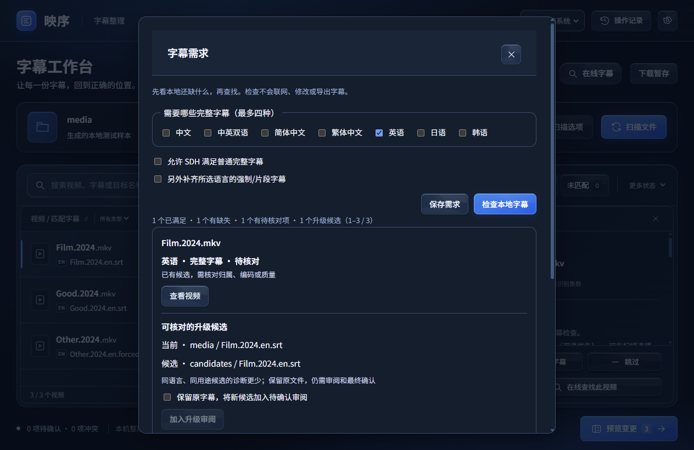

# 映序 0.12.0-rc.2

匹配更清楚，核对更从容。

## 本次更新

- 更懂文件名。分别识别片名、年份、季集与片源版本；集号范围和多集字幕也能参与核对。
- 看得懂的匹配。展示采纳或需要确认的依据，同名、不同年份、季集不符和多个视频争用字幕时，提醒你进一步确认。
- 让不同字幕各就其位。简体、繁体、不同语言、强制字幕和 SDH 可以分别保留，更换时只替换相同语言与用途。
- 新增字幕检查。在工作台或下载暂存查看时间、空正文、重复、阅读速度等问题，定位原始行并预览片段；编码不确定时由你选择。
- 检查只读取文件。支持 SRT、ASS、SSA、VTT，不擅自修复、改编码或导出视频内字幕。检查失败时保留列表，方便继续核对。
- 清楚知道还缺什么。按语言、简繁与用途列出已满足、缺失和待核对的字幕；新候选先审阅，已有字幕保留。
- 多一份片源依据。按需读取同名 NFO 和视频头尾指纹，也可为当前作品手动填写 IMDb 标识。
- 字幕早了，还是晚了。手动调整时间，或用可信本地参考字幕对齐；先看结果，再加入审阅，最后确认整理。
- 可选音轨同步。选择本机 FFmpeg 和音轨后分析，复用本地缓存。静音、对白不足和不可信结果会停止，不把输出文件的出现当成成功。
- 疑难匹配，多看一眼正文。主动选择同语言参考后，比较前后段文字，结果仅作辅助，不自动改配。
- 查找更从容。临时网络故障有限重试，限流遵守等待时间；验证码和登录步骤仍需你完成，取消与重启不会继续旧请求。

符合语言偏好的内嵌字幕仍直接通过。扫描与预览不会修改媒体；整理、恢复与撤销仍需明确确认，已有文件不会被覆盖。旧草稿保留人工关联，规则更新后需要重新核对。

## 使用与边界

本次为 Windows 预发布版。完整解压 ZIP 后运行 `YingXu.exe`，请保留同目录全部文件。先关闭旧版；升级前退出应用并备份本地数据目录，详见随包使用说明。包内已附参考字幕引擎；音轨同步另需在界面选择你信任的本机 FFmpeg，本包不附带该工具。

验证结果见随包 `docs/RELEASE_VALIDATION.md`。源代码已通过分组测试和真实窗口检查，冻结运行包单独验证；不同批次测试不合并计算。

质检结果不代表字幕一定属于该影片或已时间同步。真实片库匹配准确率与持续高刷新率目标尚未完成验收；网站验证码等必要步骤仍需人工处理。本版未签名，未在全新 Windows 环境测试。

原创部分采用 PolyForm Noncommercial 1.0.0；商业用途需单独授权。第三方组件保留各自许可与署名；同步引擎及其依赖在独立进程按需运行，相关原文与版本清单随包提供。
